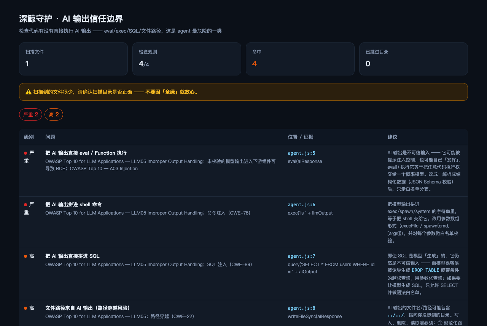

# @deepwhale-cn/dsh-ai-output-trust

[](https://dsh-plugin.org/plugins/feely0208/dsh-ai-output-trust)


**关键词**：AI 输出 · 提示注入 · 提示词注入 · 任意代码执行 · 大模型安全 · AI 安全 · LLM 安全
**Keywords**: AI output trust · prompt injection · LLM security · code execution · OWASP LLM
**AI 输出信任边界** —— 检查代码有没有直接执行 AI 输出。

## 不装它会怎样

你的 agent 里有这么一行：

```js
eval(aiResponse);
```

想法是「让模型生成一小段脚本，我执行它」。

**但 AI 输出是不可信输入** —— 它可能被提示注入控制，也可能自己发挥。
你等于把**任意代码执行权交给了一个概率模型**。

OWASP 把这单列为 **LLM05 Improper Output Handling**。

## 它查什么

| 级别 | 内容 |
|---|---|
| 🔴 严重 | `eval(aiResponse)` / `new Function(...)` |
| 🔴 严重 | AI 输出拼进 `exec` / `spawn` |
| 🟠 高 | AI 输出拼进 SQL |
| 🟠 高 | 文件路径来自 AI 输出（路径穿越）|

## 它不会误报「只是调了模型」

变量识别用**精确命名**，不是「看到 `.content` 就报」。

**这段不报**（调了模型，但当成不可信输入处理）：
```js
const raw = result.choices[0].message.content;
const parsed = safeJsonParse(raw);
if (!schema.validate(parsed)) throw new Error('invalid');
```

**这段报**：
```js
eval(aiResponse);
```

## 正确的做法

```
AI 输出 → 结构化解析 → Schema 校验 → 白名单分支
        → 参数化查询
        → 路径规范化 + 断言在允许根目录内
```

## 安装

```bash
dsh plugin --profile web add @deepwhale-cn/dsh-ai-output-trust
# 或纯 CLI
npx @deepwhale-cn/dsh-ai-output-trust
```

## 用法

```bash
dsh-ai-output-trust --demo          # 看检出效果
dsh-ai-output-trust --list-rules    # 列出规则和依据
dsh-ai-output-trust --html r.html
```



## 边界

- **只查四种明确的高危用法**（eval / shell / SQL / 路径）。其它「间接信任」不在范围。
- **靠变量命名识别** —— 建议统一命名（`ai*` / `llm*` / `model*`），否则会漏。
- **不做数据流分析**，只看调用点附近。
- 与 [dsh-ci-guard](https://github.com/feely0208/dsh-ci-guard) 分工：那个查 GitHub Actions 脚本注入，这个查运行时。

本插件是一个工具。使用者必须遵守所在地区法律法规，**对使用本项目造成的任何后果自行承担责任。**

## License

MIT © 深鲸 DeepWhale
